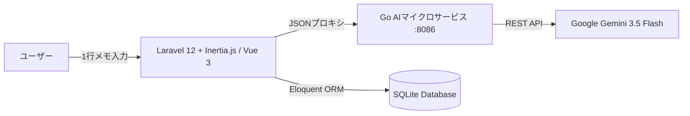

# BodyMetric (ボディメトリック)

> **人が対応するのは「日々の計測値の1行入力のみ」。**  
> 最初に設定した目標値へのアプローチと次の一手を、Gemini 3.5 Flash が処方する次世代肉体改造・トレーニング管理ダッシュボード。

[](https://github.com/mizoe0829)
[-FF2D20.svg)](https://laravel.com)
[](https://inertiajs.com)
[](https://tailwindcss.com)
[](https://golang.org)
[](https://sqlite.org)

---

## 🎯 プロダクト概要

従来のトレーニング・体重記録アプリは「種目を選んで、重量を入れて、回数を入れて、体脂肪率を入れて…」と入力工数が多く、三日坊主になりがちでした。  
**BodyMetric** は、入力の煩わしさを極限まで削ぎ落とし、**「日々の計測値の入力のみ」** に特化。

ユーザーが **「68.4kg 17.8% ベンチ75kg 10回3セット 胸に効いた」** のように自然言語で1行打ち込むだけで、AIが自動的に体重・体脂肪率・種目・重量・レップ数・メモへ構造化。  
さらに、開始時に設定した **「目標値（体重・体脂肪率・期日）」** とのギャップをリアルタイムに計算し、**「進捗ペース診断」「目標期日ギャップ」「明日やるべきトレーニング（部位・種目・負荷）」** を即座にアドバイスします。

---

## 🌟 主な機能

1. **ハイブリッド自然言語ログ入力**
   - 1行メモを入力するだけで、Gemini AIが数値と筋トレ種目を自動抽出・パース。
   - 抽出プレビューを確認してワンクリックで即座にデータベース保存。
2. **目標値（Goal）トラッキング & アプローチ診断**
   - 目標体重・体脂肪率と現在値の差分（残kg、残%）をプログレスバーで可視化。
   - 期日までの残り日数と現在の推移ペースを照合し、前倒し/オントラック/要調整を自動判定。
3. **AIパーソナルトレーナー処方箋 (Go × Gemini 3.5 Flash)**
   - **ペース診断**: 直近の推移と目標から客観的な進捗状況をフィードバック。
   - **タイムラインギャップ**: 期日達成に向けた週あたり推奨減少ペースを算出。
   - **次の一手（明日のおすすめ筋トレ）**: 直近鍛えた部位の超回復を考慮し、明日刺激すべき部位・種目・重量を具体的に提案。
4. **体組成・実績推移グラフ**
   - 体重・体脂肪率の折れ線グラフ（目標ライン付き）。
   - クリーンで視認性の高いモダンダッシュボードUI。

---

## 🏗️ システムアーキテクチャ



- **Backend / Web**: PHP 8.2 + Laravel 12 + Inertia.js
- **Frontend**: Vue 3 (Composition API / `<script setup>`) + Tailwind CSS v4 + Chart.js
- **AI Microservice**: Go (ポート 8086) + Google Gemini API (`gemini-3.5-flash`)
- **Database**: SQLite (WALモード)

---

## 🚀 起動方法（2つのスタイル）

### 🌟 方法A: Windows ワンクリック起動（最速・手軽）
1. `start.bat` をダブルクリックします。
   - Go AI マイクロサービス (ポート8086) と Laravel Web サーバー (ポート8000) が自動起動し、ブラウザで `http://localhost:8000` が開きます。
2. 終了したいときは `stop.bat` をダブルクリックするだけで全プロセスが安全に停止します。

### 🐳 方法B: Docker Compose（完全ポータブル・コンテナ運用）
Docker Desktop がインストールされている場合、以下のコマンド一発で立ち上がります。

```bash
# コンテナビルド＆バックグラウンド起動
docker compose up -d --build

# ログ確認
docker compose logs -f

# 停止
docker compose down
```
- ブラウザで `http://localhost:8000` にアクセスします。
- SQLite データベース（`database/`）はホスト側にボリュームマウントされているため、コンテナを破棄・再作成してもデータは保持されます。

---

## 🛠️ 開発者向け手動セットアップ（ネイティブ環境）
```bash
# リポジトリ直下にて依存関係インストール
composer install
npm install

# 環境変数の設定
cp .env.example .env
# .env 内に AI_SERVICE_URL=http://127.0.0.1:8086 などを確認
php artisan key:generate

# データベースマイグレーション & 初期シード
php artisan migrate --seed
```

### 3. AIマイクロサービスの起動
```bash
cd ai-service
# .env に GEMINI_API_KEY を設定
go run main.go
# => 8086 ポートで待機
```

### 4. Webサーバー & フロントエンドの起動
```bash
# Laravel Webサーバー (ポート 8000)
php artisan serve

# Vite 開発サーバー (ポート 5173)
npm run dev
```

ブラウザで `http://localhost:8000` を開きます。

---

## 📝 開発者・クレジット

- **Developer**: mizoe ([@mizoe0829](https://github.com/mizoe0829))
- **License**: MIT
